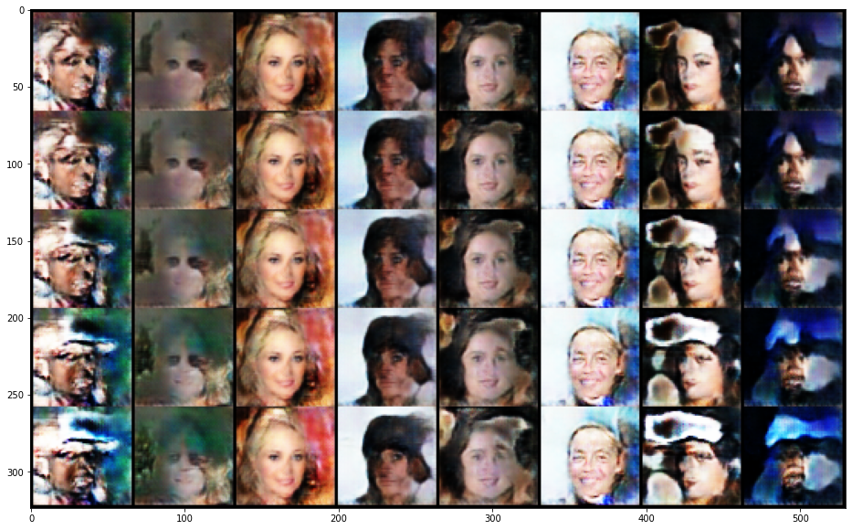
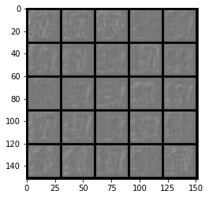
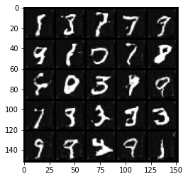
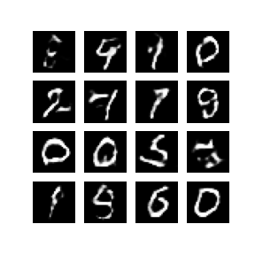
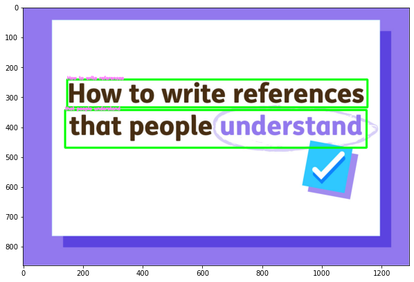

# Sooraj Abraham · Deep Learning Portfolio

AI Perception Engineer (Berlin) — real-time computer vision for embedded and edge devices.
This repo also holds personal projects in generative models, computer vision, 3D reconstruction and NLP.
The styled portfolio site is in [`index.html`](index.html) and is live at https://soorajabraham1.github.io.

---

## [Controllable GAN](https://github.com/soorajabraham1/Controllable-GAN)
* Trained on the CelebA dataset to generate new faces.
* Controlled generation of attributes such as smiling, beard and bald head.

## [Wasserstein GAN with Gradient Penalty](https://github.com/soorajabraham1/Wasserstein-GAN-with-Gradient-Penalty)
* GANs are powerful generative models but suffer from training instability.
* WGAN improves stability, but weight clipping (used to enforce the Lipschitz constraint) can still cause low-quality samples or failure to converge.
* WGAN-GP instead penalises the norm of the critic's gradient with respect to its input.

| Epoch 1 | Epoch 85 |
|:---:|:---:|
|  |  |

## [DC-GAN](https://github.com/soorajabraham1/Computer-Vision--DCGAN)
* Trained a deep convolutional GAN in TensorFlow.
* Generated MNIST digits after training the generator and discriminator.
* Wrote a step-by-step implementation blog on Medium.

## Conditional GAN
* Generates MNIST digits conditioned on a class label.
* The input is a noise vector concatenated with a one-hot encoded class vector.

## [Optical Character Recognition](https://github.com/soorajabraham1/Optical-Character-Recognition-with-EasyOCR-PyTorch)
* Used EasyOCR (PyTorch), a ready-to-use OCR library.
* Extracted words from images and displayed the extracted sentences on the image itself.

## [Sentiment Analysis (NLP)](https://github.com/soorajabraham1/Sentiment_Analysis_NLP)
* Classifies text as positive, negative or neutral.
* Scraped data from Twitter and cleaned it.
* Applied lemmatization (e.g. *better* → *good*) and removed stop words.
